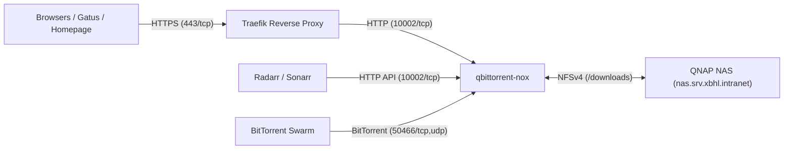

# qBittorrent

> Version: `5.2.4-1` | Image: `ghcr.io/qbittorrent/docker-qbittorrent-nox:5.2.4-1` | Upstream: https://github.com/qbittorrent/qBittorrent

Headless qBittorrent (`qbittorrent-nox`) BitTorrent download client for the homelab media stack on `media.vm.xbhl.intranet`, backed by shared QNAP NFSv4 storage.

## Overview

| Property | Value |
| :--- | :--- |
| **Domain** | `https://qbittorrent.intranet.xbhl.online` |
| **Node** | `media.vm.xbhl.intranet` |
| **Ingress** | Direct Traefik TLS + Cloudflare DNS; host ports `10002/tcp` (API) and `50466/tcp,udp` (BitTorrent) |
| **Authentication** | Native qBittorrent WebUI authentication (no Authelia middleware) |
| **Ecosystem** | Radarr & Sonarr download client, Gatus health checks, Homepage `Media` widget, and WUD |

## Architecture & Key Decisions

- **Wrapper-Built Headless Daemon**: Runs `qbittorrent-nox` on `media.vm.xbhl.intranet` via the official `qbittorrent/docker-qbittorrent-nox` Alpine wrapper image, paired with `src/scripts/healthcheck.sh` to verify process liveness, WebUI HTTP responsiveness, and active NFSv4 read/write access.
- **Shared QNAP NFSv4 Media Tree**: Mounts the QNAP NAS torrent export at `/downloads` over soft-mounted NFSv4 within the shared QNAP `Media` storage tree and media group ownership, enabling Radarr and Sonarr to import completed downloads via atomic hardlinks.
- **Multi-Path Ingress & Peer Networking**: Serves the HTTPS WebUI behind Traefik (`qbittorrent.intranet.xbhl.online`) while publishing `10002/tcp` on the VM for internal `*arr`/Homepage API polling and `50466/tcp,udp` for BitTorrent peer traffic.
- **Native WebUI Authentication**: Deliberately omits `authelia@file` on the Traefik router because `*arr` clients, Homepage, and Gatus (`/api/v2/sync/maindata`) rely on qBittorrent's built-in WebUI `/api/v2` authentication and LAN subnet bypass rules.

## Upgrades & Maintenance

- **Upstream & Wrapper Sources**: Core client releases originate in https://github.com/qbittorrent/qBittorrent (`wud.link.template`), while container images, Alpine/Boost/libtorrent builds, and `-<revision>` rebuilds are maintained in https://github.com/qbittorrent/docker-qbittorrent-nox.
- **Version & Flavor Constraints**: Locked via `wud.tag.include` (`^\d+\.\d+\.\d+-\d+$$`) to default libtorrent v2 `<major>.<minor>.<patch>-<revision>` tags, excluding `-lt1` (libtorrent v1), `alpha`, `devel`, and `latest`; image must retain BusyBox `pgrep`, `wget`, `stat`, `touch`, and `rm` for `src/scripts/healthcheck.sh`.
- **Intentional Choices (Do Not Propose)**: Keep native WebUI auth without `authelia@file`, omit upstream's `read_only: true` (`entrypoint.sh` rewrites `/etc/passwd` and `/etc/group` when applying custom `PGID`), and preserve published `10002/tcp` + `50466/tcp,udp` ports and active `.healthcheck.test` NFS write checks.
- **Upgrade & CI Gotchas**: `.gitlab-ci.yml` sets mixed-case `service-name: qBittorrent` (making `test:qBittorrent:docker-compose` case-sensitive) and DinD mounts live `nas.srv.xbhl.intranet` NFSv4 directly; keep port `10002` synchronized across WebUI config, ports, Traefik, and healthcheck, and do not add `tty: true` while `QBT_LEGAL_NOTICE="confirm"` is quoted (`entrypoint.sh` compares unquoted `confirm`).
