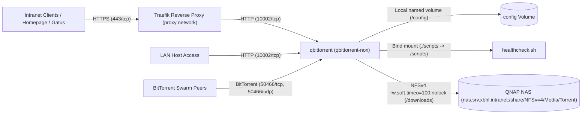

# qBittorrent

> Version: `5.2.4-1` | Image: `ghcr.io/qbittorrent/docker-qbittorrent-nox:5.2.4-1` | Upstream: https://github.com/qbittorrent/qBittorrent

Headless qBittorrent (`qbittorrent-nox`) BitTorrent client and WebUI deployed on `media.vm.xbhl.intranet`, backed by QNAP NFSv4 media storage (`/downloads`).

## Service Overview

| Property | Value |
| :--- | :--- |
| **Domain** | `https://qbittorrent.intranet.xbhl.online` |
| **Primary Node** | `media.vm.xbhl.intranet` (`Proxmox VM`) |
| **Deploy Path** | `/opt/containers/qbittorrent` |
| **Ingress Strategy** | `Direct (Traefik + Cloudflare DNS)` |
| **Topology Archetype** | `Standalone Application` |
| **Authentication** | `Built-in qBittorrent WebUI Auth` |
| **Ecosystem** | Gatus (`qbittorrent` group: `/api/v2/sync/maindata` connection check + Docker container health), Homepage (`Media` group `qbittorrent` widget), WUD (`^\d+\.\d+\.\d+-\d+$$`); no Authelia integration |

## Architecture & Communication

- **Container & Wrapper Architecture**: Single Compose service `qbittorrent-nox` (`container_name: qbittorrent`) running `ghcr.io/qbittorrent/docker-qbittorrent-nox`. While core client releases originate in `qbittorrent/qBittorrent`, the container image is built from source on Alpine Linux by the official wrapper repository `https://github.com/qbittorrent/docker-qbittorrent-nox` (bundling Boost, `libtorrent`, `/sbom.txt`, and `/entrypoint.sh` to apply `PUID=1000`, `PGID=988`, `TZ=Europe/Warsaw`, `QBT_LEGAL_NOTICE="confirm"`, `QBT_WEBUI_PORT=10002`, and `QBT_TORRENTING_PORT=50466`).
- **Ingress & BitTorrent Ports**: Attached to the external `proxy` Docker network with Traefik router `qbittorrent-router` (`Host(\`qbittorrent.intranet.xbhl.online\`)`, `entrypoints=websecure`, `tls=true`, forwarding to port `10002` without `authelia@file` middleware; DNS record managed via `cloudflare-dns-strategy: "direct"`). Host ports `10002:10002/tcp` (WebUI / `/api/v2/*`) and `50466:50466/tcp` + `50466:50466/udp` (BitTorrent peer traffic) are published directly on `media.vm.xbhl.intranet`.
- **Storage & QNAP NFSv4 Mounts**:
  - `config` -> `/config`: Docker-managed local named volume (`driver: local`) persisting qBittorrent configuration and torrent state across redeployments.
  - `scripts` -> `/scripts`: local bind volume (`type: "none"`, `o: "bind"`, `device: "./scripts"`) mounting `src/scripts/healthcheck.sh`.
  - `downloads` -> `/downloads`: Docker NFSv4 volume (`type: nfs`, `o: addr=nas.srv.xbhl.intranet,rw,soft,timeo=100,nolock`, `device: nas.srv.xbhl.intranet:/share/NFSv=4/Media/Torrent`) using `PUID=1000` / `PGID=988` for QNAP share ownership.
- **Healthcheck**: Executes `/bin/sh /scripts/healthcheck.sh /downloads http://127.0.0.1:10002` (`interval: 10s`, `timeout: 5s`, `retries: 5`, `start_period: 10s`), validating the `qbittorrent-nox` process (`pgrep -x`), WebUI HTTP responsiveness (`wget --spider`), and active NFSv4 read/write access (`stat`, `touch`, and `rm` on `/downloads/.healthcheck.test`).

## Required GitLab CI/CD Variables

No project-scoped GitLab CI/CD variables are defined (`0` project variables). The `.gitlab-ci.yml` pipeline (`$CI_SERVER_FQDN/home-lab/automations/docker-compose-service-deployment`) consumes the following inherited `home-lab` group variables:

| Variable | Scope | Purpose |
| :--- | :--- | :--- |
| `SSH_USER` | `home-lab` group | SSH username for `media.vm.xbhl.intranet` (`vm-ssh-username`) |
| `SSH_PRIVATE_KEY` | `home-lab` group | SSH private key for `media.vm.xbhl.intranet` (`vm-ssh-private-key`) |
| `CLOUDFLARE_ZONE_ID` | `home-lab` group | Cloudflare Zone ID for `xbhl.online` (`cloudflare-zone-id`) |
| `CLOUDFLARE_DNS_API_TOKEN` | `home-lab` group | Cloudflare DNS API token for `direct` record management (`cloudflare-dns-api-token`) |

## Upgrades & Maintenance

- **Upstream & Wrapper Sources**: Image built by wrapper repo https://github.com/qbittorrent/docker-qbittorrent-nox (`QBT_*` entrypoint env vars, Alpine/Boost/libtorrent stack, and `/sbom.txt`); core releases tracked via `wud.link.template`, while `-<revision>` wrapper rebuilds must be checked in https://github.com/qbittorrent/docker-qbittorrent-nox/commits/main.
- **Version & Flavor Constraints**: Locked via `wud.tag.include` (`^\d+\.\d+\.\d+-\d+$$`) to default libtorrent 2.x `<major>.<minor>.<patch>-<revision>` tags on `ghcr.io/qbittorrent/docker-qbittorrent-nox`, excluding `-lt1-<revision>` (libtorrent 1.2.x), `alpha`, `devel`, and `latest` tags; runtime image must retain Alpine BusyBox utilities (`pgrep`, `wget`, `stat`, `touch`, `rm`) used by `src/scripts/healthcheck.sh`.
- **Intentional Choices (Do Not Propose)**: Direct Traefik ingress omits `authelia@file` because Gatus (`/api/v2/sync/maindata`), Homepage, and API clients rely on native WebUI auth/subnet bypass; `read_only: true` (from upstream's example Compose) is intentionally omitted because `PGID=988` requires `/entrypoint.sh` to rewrite `/etc/passwd` and `/etc/group`; host ports `10002/tcp` and `50466/tcp,udp` (`QBT_TORRENTING_PORT`), `PUID=1000`/`PGID=988` for QNAP NFS ownership, and active `.healthcheck.test` NFS write probes on soft-mounted `/downloads` are intentional.
- **Upgrade & CI Gotchas**: `delete-existing-container-files: true` wipes `/opt/containers/qbittorrent` before `scp`, so `config` MUST stay a Docker named volume (`driver: local`), never a `./config` bind mount; `.gitlab-ci.yml` uses mixed-case `service-name: qBittorrent` (making `test:qBittorrent:docker-compose` case-sensitive) and DinD mounts live `nas.srv.xbhl.intranet:/share/NFSv=4/Media/Torrent` directly without `/tmp` overrides; keep `10002` synchronized across `QBT_WEBUI_PORT`, `ports`, Traefik loadbalancer port, and `healthcheck.test`; do not add `tty: true` unless `QBT_LEGAL_NOTICE="confirm"` is unquoted (`entrypoint.sh` compares `confirm` without stripping literal quotes).
